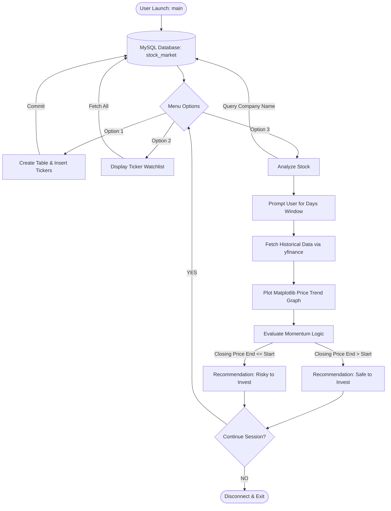

# Stovest 📈 — Stock Market Investment Advisor

[](https://www.python.org/)
[](https://www.mysql.com/)
[-purple.svg)](https://pypi.org/project/yfinance/)
[](https://matplotlib.org/)
[](LICENSE)
[]()

> **Stovest** is an automated, lightweight CLI-based stock market analysis and investment advisory tool. It blends persistent relational database storage with real-time financial market data from Yahoo Finance to analyze stock trends, display visual price movements, and generate investment recommendations.

---

## 📑 Table of Contents

- [About The Project](#about-the-project)
- [Key Features](#key-features)
- [How It Works](#how-it-works)
  - [Architectural Flow](#architectural-flow)
  - [Investment Logic & Decision Engine](#investment-logic--decision-engine)
- [Efficiency & Performance](#efficiency--performance)
- [Tech Stack & Prerequisites](#tech-stack--prerequisites)
- [Installation & Setup](#installation--setup)
  - [1. Clone Repository](#1-clone-repository)
  - [2. Environment & Dependencies](#2-environment--dependencies)
  - [3. MySQL Database Configuration](#3-mysql-database-configuration)
- [Usage Guide](#usage-guide)
  - [Menu Options](#menu-options)
  - [Interactive Walkthrough](#interactive-walkthrough)
- [Project Structure](#project-structure)
- [Security & Best Practices](#security--best-practices)
- [Roadmap & Enhancements](#roadmap--enhancements)
- [Contributing](#contributing)
- [Disclaimer](#disclaimer)
- [License](#license)

---

## 💡 About The Project

In the fast-moving financial domain, investors often need a fast, low-friction mechanism to query stock tickers, retain their watchlist in a local database, and quickly inspect short-to-medium-term price momentum without navigating heavy web platforms or paying for expensive Bloomberg/Refinitiv terminals.

**Stovest** simplifies market tracking into a high-performance console workflow:
1. **Catalog Watchlists**: Maintain mapping between company names and international ticker symbols in a MySQL database.
2. **Stream Historical OHLC Data**: Fetch live data on-demand via Yahoo Finance (`yfinance`).
3. **Graph Visual Trends**: Render interactive Matplotlib charts plotting historical closing prices.
4. **Generate Advice**: Formulate directional investment recommendations based on multi-day trajectory analysis.

---

## ✨ Key Features

- **Relational Ticker Database**: Store, retrieve, and organize watchlist company names paired with exchange-specific tickers (e.g., `TCS.NS`, `RELIANCE.NS`, `AAPL`, `MSFT`, `GOOGL`).
- **Real-Time Market Ingestion**: Dynamically pulls up-to-the-minute historical price quotes across customized day ranges directly from Yahoo Finance API.
- **Interactive Price Visualizations**: Generates date-indexed closing price charts with markers, clean rotational axes, legends, and gridlines.
- **Automated Investment Advice Engine**: Automatically analyzes start-vs-end trajectory over the requested window and outputs an immediate actionable signal:
  - 🟢 **Safe to Invest!** (Positive upward momentum)
  - 🔴 **Risky to Invest!** (Negative downward trend)
- **Zero Overhead**: Console-driven terminal interface with immediate response times and negligible resource consumption.

---

## ⚙️ How It Works

### Architectural Flow



### Investment Logic & Decision Engine

The current engine evaluates short-term directional momentum over a specified observation window $N$ days:

1. **Data Ingestion**: Let $\{P_0, P_1, \dots, P_{N-1}\}$ represent the daily closing prices retrieved for ticker $T$.
2. **Delta Calculation**:
   $$\Delta P = P_{N-1} - P_0$$
3. **Signal Classification**:
   - If $\Delta P > 0 \implies$ Net capital appreciation over the window $\implies$ **"Safe to Invest!"**
   - If $\Delta P \le 0 \implies$ Net capital depreciation/stagnation $\implies$ **"Risky to Invest!"**

---

## ⚡ Efficiency & Performance

Stovest is built with a focus on speed, low compute overhead, and minimal dependency bloat:

| Dimension | Performance Characteristic | Technical Details |
| :--- | :--- | :--- |
| **Time Complexity** | **$\mathcal{O}(N)$** | Data parsing and plotting operate in linear time proportional to the number of days $N$. |
| **Database Retrieval** | **Sub-millisecond ($< 5\text{ ms}$)** | Simple indexed primary lookups against local MySQL instance. |
| **API Latency** | **$200 - 800\text{ ms}$** | Streamlined Yahoo Finance queries fetching lightweight compressed pandas series. |
| **Memory Consumption** | **$< 60\text{ MB}$** | Python runtime + Matplotlib plot canvas in memory; cleans up after closing figure window. |
| **Disk Footprint** | **Minimal ($< 5\text{ KB}$ script)** | No bulky heavy frameworks or bloatware required. |

### Why It's Efficient:
- **Direct REST/Data Streaming**: Fetches only the requested period (`period=Nd`), bypassing unnecessary multi-year data overhead.
- **Lean Transaction Management**: MySQL connection maintains persistent pooling throughout the session with explicit transaction commits and safe cursor teardowns.
- **Fail-Safe Exception Guard**: Comprehensive `try-except` wrappers prevent crashes when ticker symbols or connectivity issues occur.

---

## 🛠️ Tech Stack & Prerequisites

- **Language**: Python 3.8 or higher
- **Database**: MySQL Server 8.0+ / MariaDB
- **Core Libraries**:
  - [`yfinance`](https://pypi.org/project/yfinance/): Financial market historical data scraping and REST client.
  - [`matplotlib`](https://matplotlib.org/): Interactive 2D plotting and graphical trend generation.
  - [`mysql-connector-python`](https://pypi.org/project/mysql-connector-python/): Native Oracle-supported Python driver for MySQL communication.

---

## 🚀 Installation & Setup

### 1. Clone Repository

```bash
git clone https://github.com/DhineshkarthikR/stovest.git
cd stovest
```

### 2. Environment & Dependencies

It is recommended to use a Python virtual environment:

```bash
# Create virtual environment
python -m venv venv

# Activate virtual environment
# On Windows:
.\venv\Scripts\activate
# On Linux/macOS:
source venv/bin/activate

# Install required dependencies
pip install -r requirements.txt
```

*(Or install manually: `pip install yfinance matplotlib mysql-connector-python`)*

### 3. MySQL Database Configuration

1. Launch your MySQL command line client or workbench:
   ```sql
   mysql -u root -p
   ```

2. Create the target database:
   ```sql
   CREATE DATABASE stock_market;
   ```

3. *(Optional)* Update your MySQL connection credentials in `STOCK MARKET INVETSMENT ADVISOR.py`:
   ```python
   mycon = mysql.connect(
       host="localhost",
       user="root",
       password="YOUR_PASSWORD",    # Update your password here
       database="stock_market"
   )
   ```

---

## 🖥️ Usage Guide

Run the script directly from your terminal:

```bash
python "STOCK MARKET INVETSMENT ADVISOR.py"
```

### Menu Options

```text
1. CREATE TABLE OF TICKER SYMBOL.
2. DISPLAY TICKER SYMBOL.
3. ANALYZE THE STOCK.
```

### Interactive Walkthrough

#### Option 1: Populate Watchlist
Enter your favorite tickers. For Indian exchanges (NSE/BSE), append `.NS` or `.BO` (e.g., `TCS.NS`, `INFY.NS`). For US exchanges (NASDAQ/NYSE), enter standard symbols (e.g., `NVDA`, `TSLA`).

```text
Enter your choice: 1
How many records do you want to update? 2
Enter the serial number: 1
Enter the company name: Tata Consultancy Services
Enter the ticker symbol (e.g., TCS.NS): TCS.NS
Enter the serial number: 2
Enter the company name: Apple Inc
Enter the ticker symbol (e.g., TCS.NS): AAPL
```

#### Option 2: View Stored Tickers
Inspect all tickers stored in your MySQL database:

```text
Enter your choice: 2
| 1   | Tata Consultancy Services | TCS.NS |
| 2   | Apple Inc                 | AAPL   |
```

#### Option 3: Analyze Stock & Generate Recommendation
Fetch live data, plot trend graph, and view the investment decision:

```text
Enter your choice: 3
Enter the company ticker symbol (e.g., TCS.NS, RELIANCE.NS): TCS.NS
How many days of stock data would you like to analyze? 30

[A Matplotlib plot window opens displaying historical closing prices]

Tata Consultancy Services (TCS.NS): Stock price is increasing.

Recommendation: Safe to Invest!
```

---

## 📂 Project Structure

```text
stovest/
├── .gitattributes                    # Git file formatting configuration
├── requirements.txt                  # Python project dependencies
├── README.md                         # Detailed project documentation
└── STOCK MARKET INVETSMENT ADVISOR.py# Core application logic and entrypoint
```

---

## 🔒 Security & Best Practices

- **Credential Protection**: Avoid committing hardcoded passwords in production. It is recommended to use an `.env` file with `python-dotenv` or OS environment variables:
  ```python
  import os
  db_password = os.getenv("DB_PASSWORD", "1234")
  ```
- **SQL Parameterization**: The project employs parameterized SQL queries (`%s`) across insertions and lookups to prevent SQL injection vulnerabilities.

---

## 🔮 Roadmap & Future Enhancements

- [ ] **Technical Indicators**: Add Simple Moving Averages (SMA 20/50/200), Exponential Moving Average (EMA), Relative Strength Index (RSI), and MACD.
- [ ] **Automated Stop-Loss & Target Projections**: Calculate volatility-adjusted risk/reward ratios.
- [ ] **Config / `.env` Support**: Decouple database credentials into a standalone configuration file.
- [ ] **Modern Web Dashboard**: Provide a Streamlit or Flask web GUI alongside the terminal interface.
- [ ] **Portfolio Tracking**: Enable multiple portfolio allocations with simulated profit/loss tracking.

---

## 🤝 Contributing

Contributions, issues, and feature requests are welcome!

1. Fork the repository
2. Create your feature branch (`git checkout -b feature/AmazingFeature`)
3. Commit your changes (`git commit -m 'Add some AmazingFeature'`)
4. Push to the branch (`git push origin feature/AmazingFeature`)
5. Open a Pull Request

---

## ⚠️ Disclaimer

> **Notice**: *This software is built for educational, analytical, and informational purposes only. The stock recommendations generated by this software do not constitute professional financial advice, endorsement, or trade recommendations. Stock markets are subject to volatility and risks. Always conduct your own thorough research or consult with a licensed financial advisor before making any investment decisions.*

---

## 📄 License

Distributed under the **MIT License**. See `LICENSE` for more information.

---

<p align="center">
  Developed by <a href="https://github.com/DhineshkarthikR"><b>Dhineshkarthik R</b></a>
</p>
