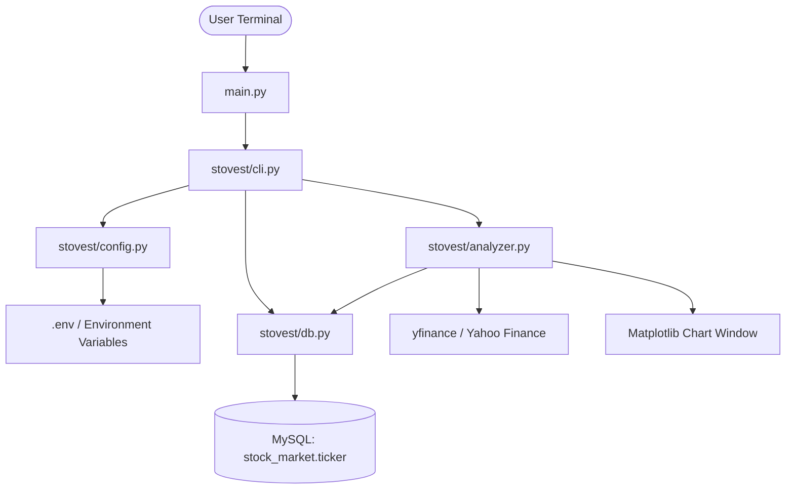

# Stovest – Stock Market Analysis & Portfolio Insights

> **Explore Markets. Understand Trends. Build Insights.**

[](https://www.python.org/)
[](https://www.mysql.com/)
[](https://pypi.org/project/yfinance/)
[](https://matplotlib.org/)
[](LICENSE)
[](https://github.com/DhineshkarthikR/stovest/stargazers)
[](https://github.com/DhineshkarthikR/stovest/network/members)
[](https://github.com/DhineshkarthikR/stovest/issues)

---

## Overview

**Stovest** is a lightweight, command-line stock market analysis application written in Python. It combines a MySQL-backed ticker watchlist with historical market data from Yahoo Finance (`yfinance`) and 2D trend visualization using Matplotlib.

The project is designed for students, developers, and market learners who want a straightforward way to store company ticker symbols, retrieve historical closing prices for a chosen day window, plot price movements, and inspect basic start-to-end directional momentum from the terminal.

---

## Table of Contents

- [Key Features](#key-features)
- [Technology Stack](#technology-stack)
- [Application Workflow](#application-workflow)
- [Architecture](#architecture)
- [Prerequisites](#prerequisites)
- [Installation & Setup](#installation--setup)
  - [1. Clone the Repository](#1-clone-the-repository)
  - [2. Virtual Environment Setup](#2-virtual-environment-setup)
  - [3. Install Dependencies](#3-install-dependencies)
  - [4. MySQL Configuration](#4-mysql-configuration)
  - [5. Environment Configuration](#5-environment-configuration)
- [Running the Application](#running-the-application)
- [Running Tests](#running-tests)
- [Project Structure](#project-structure)
- [Screenshots & CLI Preview](#screenshots--cli-preview)
- [Current Limitations](#current-limitations)
- [Future Development Roadmap](#future-development-roadmap)
- [Contributing](#contributing)
- [Financial Disclaimer](#financial-disclaimer)
- [License](#license)
- [Developer Attribution](#developer-attribution)

---

## Key Features

- **MySQL Ticker Watchlist**: Automatically initializes the `ticker` table (`S_NO`, `COMPANY_NAME`, `TICKER_SYMBOL`) if it does not exist, lets you add new ticker records, and displays stored tickers in a formatted terminal table.
- **Historical Market Data Retrieval**: Fetches historical daily OHLCV data for any valid Yahoo Finance ticker symbol (such as `AAPL`, `MSFT`, `TCS.NS`, or `RELIANCE.NS`) over a user-specified number of days (`period="<days>d"`).
- **Closing Price Visualization**: Generates a Matplotlib line chart of historical closing prices with date-indexed axes, data point markers, gridlines, and legends.
- **Basic Directional Momentum Check**: Compares the first and last closing prices within the selected window to report whether the price is `increasing`, `decreasing`, or has `insufficient data`, alongside an educational summary label.
- **Environment-Based Configuration**: Loads MySQL connection parameters from `.env` or OS environment variables via `python-dotenv`, keeping credentials out of source control.
- **Parameterized SQL Queries**: Uses parameterized `%s` placeholders in `stovest/db.py` for database inserts and lookups.
- **Unit Test Suite**: Includes `unittest`-based tests in `tests/` covering configuration loading, mocked MySQL operations, and stock analysis/plotting logic.

---

## Technology Stack

| Component | Technology | Purpose |
| :--- | :--- | :--- |
| **Language** | Python 3.8+ | Core application runtime |
| **Database** | MySQL (`mysql-connector-python>=8.0.30`) | Persistent storage for ticker symbols and company names |
| **Market Data** | `yfinance>=0.2.30` | Fetching historical stock data from Yahoo Finance |
| **Visualization** | `matplotlib>=3.7.0` | Plotting closing price trend charts |
| **Data Handling** | `pandas` (via `yfinance`) | Time-series `DataFrame` and `Series` processing |
| **Configuration** | `python-dotenv>=1.0.0` | Loading database settings from `.env` |
| **Testing & Linting** | `pytest>=7.4.0`, `flake8>=6.1.0` | Optional development dependencies (`requirements-dev.txt`) |

---

## Application Workflow

1. **Startup & Connection**: `main.py` invokes `stovest.cli.main()`, which reads database settings from `stovest.config.get_db_config()` and opens a MySQL connection via `stovest.db.get_connection()`.
2. **Interactive Menu**:
   - **Option 1 (`CREATE / POPULATE TICKER TABLE`)**: Ensures the `ticker` table exists and inserts one or more `(S_NO, COMPANY_NAME, TICKER_SYMBOL)` records.
   - **Option 2 (`DISPLAY REGISTERED TICKER SYMBOLS`)**: Queries all rows from `ticker` and prints them in a tabular CLI view.
   - **Option 3 (`ANALYZE STOCK MARKET TREND`)**: Prompts for a ticker symbol and number of days, looks up the company name in MySQL, fetches historical data via `yfinance`, renders a Matplotlib closing-price chart, and prints the start-to-end momentum evaluation.
   - **Option 4 (`EXIT`)**: Closes the cursor and database connection and exits cleanly.

---

## Architecture



---

## Prerequisites

- **Python** 3.8 or higher installed and available on your `PATH`
- **MySQL Server** 8.0+ (or compatible MariaDB instance) running locally or accessible over the network
- **Internet connection** for querying historical market data from Yahoo Finance

---

## Installation & Setup

### 1. Clone the Repository

```bash
git clone https://github.com/DhineshkarthikR/stovest.git
cd stovest
```

### 2. Virtual Environment Setup

Create and activate an isolated Python virtual environment:

```bash
python -m venv .venv
```

**Windows (PowerShell):**

```powershell
.\.venv\Scripts\Activate.ps1
```

**Windows (Command Prompt):**

```cmd
.venv\Scripts\activate.bat
```

**Linux / macOS:**

```bash
source .venv/bin/activate
```

### 3. Install Dependencies

Install runtime dependencies:

```bash
pip install -r requirements.txt
```

*(Optional)* Install development and testing dependencies:

```bash
pip install -r requirements-dev.txt
```

### 4. MySQL Configuration

Log into your MySQL server and create the database expected by Stovest:

```sql
CREATE DATABASE IF NOT EXISTS stock_market;
```

The `ticker` table is created automatically when you select **Option 1** in the CLI, or you can inspect its schema:

```sql
USE stock_market;
CREATE TABLE IF NOT EXISTS ticker (
    S_NO INT,
    COMPANY_NAME VARCHAR(100),
    TICKER_SYMBOL VARCHAR(20)
);
```

### 5. Environment Configuration

Copy `.env.example` to `.env` and update it with your MySQL credentials:

```bash
cp .env.example .env
```

On Windows PowerShell:

```powershell
Copy-Item .env.example .env
```

Edit `.env`:

```dotenv
DB_HOST=localhost
DB_PORT=3306
DB_USER=root
DB_PASSWORD=your_mysql_password_here
DB_NAME=stock_market
```

> **Note:** Never commit your `.env` file or real database passwords to version control.

---

## Running the Application

Start the modular CLI application:

```bash
python main.py
```

*(The repository also retains the original single-file prototype `STOCK MARKET INVETSMENT ADVISOR.py` for reference.)*

---

## Running Tests

Run the unit test suite using `unittest` or `pytest`:

```bash
python -m unittest discover tests
```

Or with `pytest` (if `requirements-dev.txt` is installed):

```bash
pytest
```

---

## Project Structure

```text
stovest/
├── main.py                              # Application entry point
├── stovest/
│   ├── __init__.py                      # Package metadata
│   ├── analyzer.py                      # yfinance data fetching, Matplotlib plotting, momentum check
│   ├── cli.py                           # Interactive terminal menu and handlers
│   ├── config.py                        # Environment / .env configuration loader
│   └── db.py                            # MySQL connection and ticker table operations
├── tests/
│   ├── __init__.py
│   ├── test_analyzer.py                 # Unit tests for stock analysis & plotting
│   ├── test_config.py                   # Unit tests for configuration loading
│   └── test_db.py                       # Unit tests for mocked MySQL operations
├── STOCK MARKET INVETSMENT ADVISOR.py   # Original standalone script
├── .env.example                         # Sample environment variable configuration
├── .gitignore                           # Git ignore rules
├── .gitattributes                       # Git line-ending configuration
├── requirements.txt                     # Runtime Python dependencies
├── requirements-dev.txt                 # Development/test dependencies
├── LICENSE                              # MIT License
└── README.md                            # Project documentation
```

---

## Screenshots & CLI Preview

No image screenshots are currently included in this repository. Below is an example of the interactive CLI menu output:

```text
=============================================
      STOVEST - INVESTMENT ADVISOR
=============================================
1. CREATE / POPULATE TICKER TABLE
2. DISPLAY REGISTERED TICKER SYMBOLS
3. ANALYZE STOCK MARKET TREND
4. EXIT
=============================================
Enter your choice (1-4):
```

When Option 3 is selected, a Matplotlib window opens displaying the closing price trend for the requested ticker and day range, followed by the terminal momentum summary.

---

## Current Limitations

- **Historical Data Only**: Relies on historical daily data from Yahoo Finance (`yfinance`) rather than real-time streaming market feeds.
- **Simple Momentum Heuristic**: `evaluate_momentum` only compares the start and end closing prices over the requested period; it does not calculate technical indicators (such as SMA, EMA, RSI, or MACD) or fundamental ratios.
- **No AI or Predictive Modeling**: Does not include machine learning, price forecasting, or automated portfolio optimization.
- **Educational Signal Labels**: The CLI prints simple directional labels based on net period change; these outputs are strictly for educational demonstration and do not evaluate investment safety or risk.
- **Local MySQL Dependency**: Requires a configured MySQL server to store and look up ticker records.
- **CLI & Desktop Plot Only**: Operates strictly in the terminal with local Matplotlib windows (no web interface or portfolio P&L tracking).

---

## Future Development Roadmap

Planned enhancements for future releases include:

- [ ] Technical indicators (SMA, EMA, RSI, MACD)
- [ ] Portfolio allocation and simulated profit/loss tracking
- [ ] Multi-ticker comparison charts
- [ ] Exportable analysis reports (CSV / JSON)
- [ ] Optional web dashboard interface

---

## Contributing

Contributions, bug reports, and feature suggestions are welcome.

1. Fork the repository.
2. Create a feature branch:
   ```bash
   git checkout -b feature/your-feature-name
   ```
3. Make your changes and verify tests pass (`python -m unittest discover tests`).
4. Commit your changes and push to your fork.
5. Open a Pull Request describing your changes.

---

## Financial Disclaimer

> **Important:** Stovest is an **educational and informational software project**. It does **not** provide financial, investment, tax, or legal advice, and it does not guarantee any financial returns. No stock or security should ever be considered safe to invest in solely based on historical price comparisons or automated CLI outputs. Always conduct independent research and consult a qualified, licensed financial advisor before making any investment decisions.

---

## License

This project is licensed under the **MIT License**. See the [LICENSE](LICENSE) file for details.

---

## Developer Attribution

Developed and maintained by **[Dhinesh Karthik R](https://github.com/DhineshkarthikR)**.
